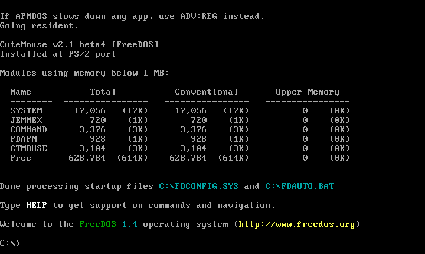
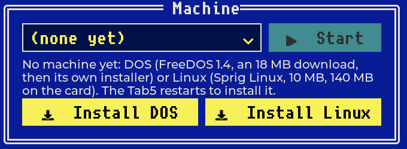
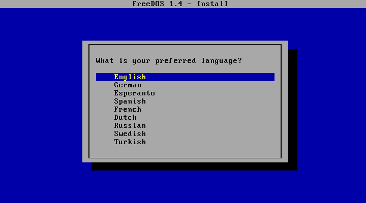
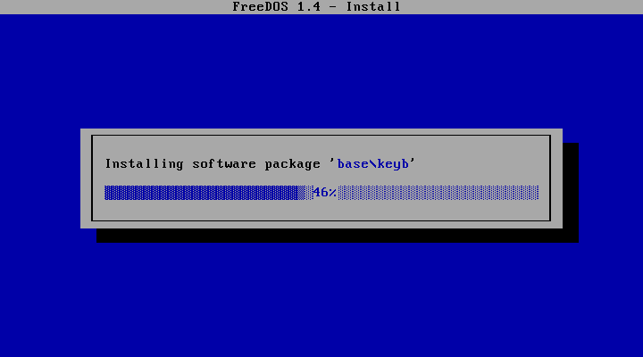
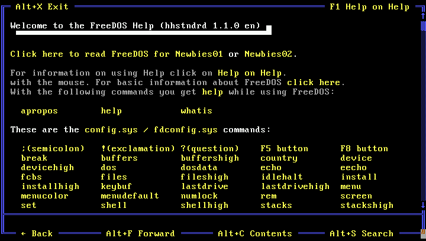
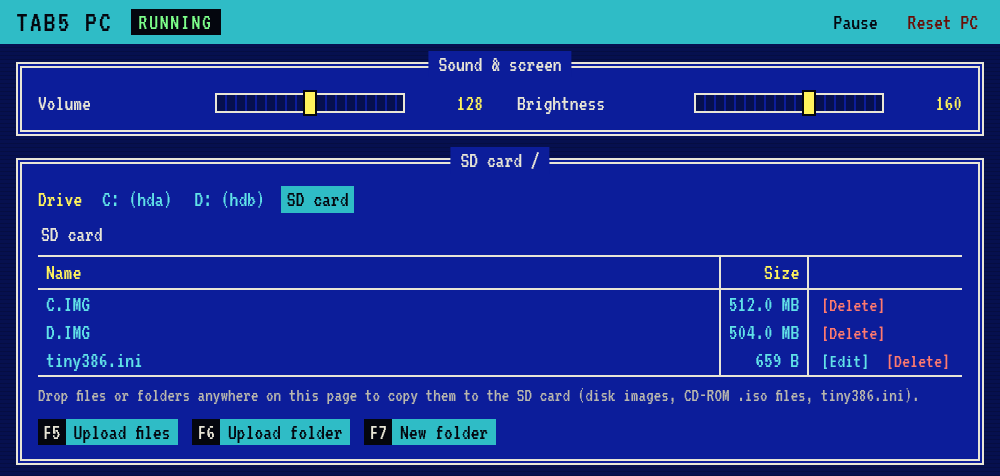
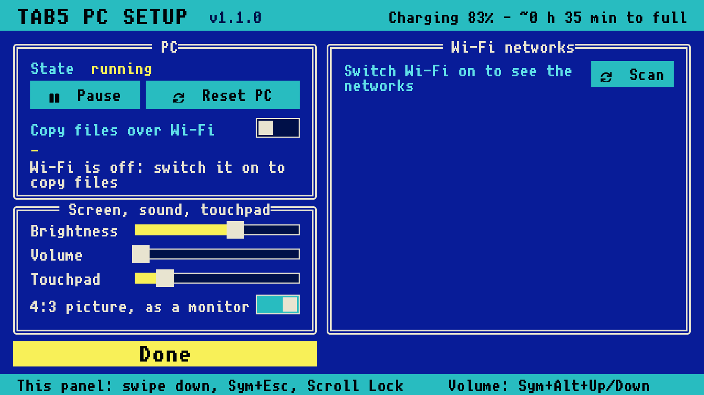

# Tab5 PC

A PC emulated on the M5Stack Tab5, built on [tiny386](https://github.com/hchunhui/tiny386): a 386/486 with VGA, a
PS/2 keyboard and mouse, a Sound Blaster 16, AdLib and PC speaker, IDE hard disks, CD-ROM images, floppies and
SeaBIOS. It runs DOS. On an empty SD card it downloads and installs FreeDOS by itself; files are copied to it over
Wi-Fi from a browser.



This is an independent project, not affiliated with or endorsed by M5Stack. It is provided as is (see `LICENSE`).

## What you need

- An M5Stack Tab5 (ESP32-P4). The Tab5 Keyboard is recommended; a USB keyboard and mouse work too.
- A microSD card, FAT32 or exFAT, with at least 1 GB free.
- A Wi-Fi network with internet access for the FreeDOS download (or prepare the card on a computer, below).

To build the firmware:

- [Arduino CLI](https://arduino.github.io/arduino-cli/) with the M5Stack board package (`m5stack:esp32`, from
  `https://static-cdn.m5stack.com/resource/arduino/package_m5stack_index.json`) and the libraries M5Unified, M5GFX
  and lvgl. Built and tested with m5stack:esp32 3.3.9, M5Unified 0.2.25, M5GFX 0.2.33 and lvgl 9.6.0.
- git, curl, make, tar with xz, a C compiler, `xxd`, and the GitHub CLI (`gh`, logged in: `gh auth login`) for
  tiny386's BIOS images.
- Python 3: `python3 -m venv .venv && .venv/bin/pip install -r requirements.txt`. Run the tools with
  `.venv/bin/python` (`tools/make_sdcard.py` and `tools/dosdisk.py` also find `.venv` by themselves).
- Optional: dosfstools (`fsck.fat`; `brew install dosfstools` on macOS), with which `tools/make_sdcard.py` and
  `tools/dosdisk.py` check the disks they write.

## Ready-made firmware

Each [release](https://github.com/yejun/tab5-pc/releases) has the firmware as one image to write at address 0
(`tab5-pc-<version>-prev3.bin`, for the Tab5's ESP32-P4, revision v1.x), with its licenses and notices and the
corresponding source. Releases have no image for ESP32-P4 v3.x while no Tab5 with that chip is out (see below to build
one). It is also in M5Burner. To write it yourself:
`esptool --chip esp32p4 write-flash 0x0 tab5-pc-1.1.0-prev3.bin`.

## Build and flash

```
tools/fetch_vendor.sh            # tiny386 at the pinned commit (with the patches in vendor/patches),
                                 # its SeaBIOS images, and ESP-Hosted's SDIO driver
tools/build.sh upload            # build and flash (port /dev/ttyACM0; or: tools/build.sh upload /dev/ttyACM1)
```

The BIOS (SeaBIOS) comes from tiny386's release and is checked against the tested images pinned in
`vendor/bios.lock`. If that release has moved on, `BIOS_FROM_SOURCE=1 tools/fetch_vendor.sh` builds it from the
pinned source instead (needs a gcc that can build 32-bit x86 code).

ESP32-P4 chips come in two families: `esptool` reports "revision v1.x" for earlier ones (the default build) and
v3.x for later ones: `CHIP=postv3 tools/build.sh upload`. A build for the wrong family does not start.

## First start: FreeDOS on an empty card

1. Put an empty card in the Tab5 and switch it on. With nothing on the card, the settings panel opens with Wi-Fi
   on: choose your network on the right, then tap **Install FreeDOS 1.4** and give the machine a name (for example
   `dos`; tap again to confirm). The Tab5 restarts into its install mode, with no PC running, and shows how it goes.

   

2. The Tab5 downloads FreeDOS 1.4's LiteUSB disk (18 MB, from freedos.org), makes the PC's hard disk
   (`/dos/C.IMG`, 512 MB, partitioned and formatted) and the machine's settings (`/tiny386-dos.ini`), and restarts
   into FreeDOS's own installer. Answer its questions: your
   language, **Yes** to proceed, **Yes** to format the drive (the installer calls it D:, as it started from its own
   disk), your keyboard, **Plain DOS system**, and **Yes** to install. (The questions that default to No need Up,
   then Enter.)

   

3. Copying the packages takes about 20 minutes. When the installer asks to reboot, say yes: the Tab5 sets the
   machine up to start from its `C.IMG` alone, removes the installer's files from the card, and adjusts `C:\FDAUTO.BAT` for this
   PC (no CD-ROM drive by default; the Sound Blaster's `BLASTER` setting). FreeDOS then starts at the `C:\>` prompt.

   

While an installer runs, the code translator (below) is off and the PC runs a little slower; it is back on once
the install is done.

**Other ways to start:**

- **An installer CD**: put an `.iso` of a bootable installer CD (for example FreeDOS's LiveCD) at the root of the
  empty card. The panel then also offers to start the PC from it, with a new, empty `C.IMG`. The PC starts from the
  CD while C: has no files, and from C: once something is installed on it.
- **Prepare the card on a computer**: `.venv/bin/python tools/make_sdcard.py` makes `sdcard/C.IMG` (FreeDOS 1.4
  with all its packages, 32 MB), `sdcard/D.IMG` (504 MB, empty) and a matching `sdcard/tiny386.ini`. Copy the three
  files to the root of the card. It starts straight at the `C:\>` prompt.

## More machines: DOS and Linux side by side

The settings panel's **Machine** frame lists the machines on the card: `default` (`/tiny386.ini`) and every one
named N (`/tiny386-N.ini`, its files in the folder `/N`). Choose one and tap **Start** twice: the Tab5 restarts into
it, and keeps starting it, through every restart, until you choose another.

**Install DOS** and **Install Linux** make a new machine (a saved Wi-Fi network is needed): give it a name, tap
again to confirm that the PC stops, and the Tab5 restarts into its install mode, with no PC running, then into the
new machine.

- **DOS**: FreeDOS 1.4, as above: its installer starts in the new machine.
- **Linux**: the latest release of [Sprig Linux](https://github.com/yejun/sprig-linux), a small Linux made for this
  PC (about 10 MB downloaded, 140 MB on the card), every file checked against the release's checksums. It starts
  with a graphics console (800 x 600); the machine's settings file says how to use the text console instead.
  Installing Linux again with the same name updates it: its kernel and loader are replaced, its disk (`root.img`,
  your files) is kept.

A name already on the card (its settings file or its folder) can't be used again, except to update Sprig Linux. If an
install fails, the screen says why, and a tap goes back to the machine there was. Serial: `machines`,
`machine <file>`, `install dos <name>`, `install linux <name>`.

## Using it



**The Tab5 Keyboard.** Aa, Ctrl and Alt are the PC's Shift, Ctrl and Alt. Sym is a layer (never sent to the PC):

| Sym + | gives | | Sym + | gives |
|---|---|---|---|---|
| 1 ... 0 | F1 ... F10 | | ← → ↑ ↓ | Home, End, Page Up, Page Down |
| - and + | F11, F12 | | Backspace | Delete |
| Del | Insert | | Aa | Caps Lock |
| the symbol keys | their second symbol | | Esc | the settings panel |

Ctrl + Alt + Delete is Ctrl + Alt + Sym + Backspace. Sym + Alt + Up/Down sets the speaker volume. The left light
shows Sym or Aa held, the right one is green while the PC runs. Docked in the keyboard, the picture is turned to
match.

**USB.** A keyboard and mouse in the Tab5's USB-A port (also through a hub, or a wireless receiver) work alongside.
Scroll Lock opens the settings panel.

**The touch screen** is a touchpad for the PC's mouse: slide to move, tap to click, tap with two fingers for the
right button, tap and touch again to drag. DOS programs need a mouse driver (CTMOUSE, which FreeDOS loads).

**Sound**: the PC speaker, the Sound Blaster 16 (`BLASTER=A220 I5 D1 H5 T6`) and AdLib play through the Tab5's
speaker.

## Copying files over Wi-Fi

Wi-Fi is off while the PC runs. Open the settings panel (swipe down from the top edge, Sym + Esc, or Scroll Lock)
and switch on **Copy files over Wi-Fi**. The Tab5 joins your network and shows its address, e.g. `http://192.168.1.50/`.
Open it in a browser:



- **The SD card tab** lists the card: disk images, CD images (`.iso`), `tiny386.ini`. Drop files or whole folders
  anywhere on the page to copy them. **Edit** opens text files (`tiny386.ini`, `.BAT`, `CONFIG.SYS`, ...); after
  saving `tiny386.ini` the page offers to restart the Tab5 with it.
- **The C: and D: tabs** open the PC's disks. This pauses the PC (DOS keeps parts of its disks in memory). When you
  press Done, or 30 s after the last change, the PC continues, restarted if anything changed. Do this at the DOS
  prompt, not while a program is saving.
- The images the PC has open can't be changed while it runs: **Delete** on one offers to stop the PC first (like
  switching it off). It stays stopped until **Start PC** restarts the Tab5.
- Long file names are stored with DOS short names (`LONGNA~1.TXT`).
- From a shell: `.venv/bin/python tools/upload.py <address> hdb /APPS ~/dos/myprog`, then
  `.venv/bin/python tools/upload.py <address> --done`.

Switch Wi-Fi off again when you are done. It is off after every restart, except one the page asks for.

> **The file manager has no password.** Anyone who can reach the Tab5 on the network can read, change and delete
> everything on the card and the PC's disks while it is on. Switch it on only on a network you trust, and never make
> it reachable from the internet (no port forwarding, no exposed host).

### The PC's network

The PC's network card (NE2000, port 300h, IRQ 9) is connected to a small network inside the Tab5 (192.168.77.0/24; the
Tab5 at .1 hands out addresses by DHCP and answers DNS queries by passing them on to your Wi-Fi network's DNS server).
While Wi-Fi is on, it is routed to your Wi-Fi network with address translation, as a home router does; with Wi-Fi off,
the PC still gets its address, and its lookups fail at once. The PC reaches your network and the internet; from your
network, ports 2222, 2323 and 8080 of the Tab5 lead to the PC's 22, 23 and 80 (an SSH, Telnet or web server running in
it). DOS needs a packet driver for the NE2000 and a TCP/IP program; serial `net` shows the card's state. The same
warning applies: anything the PC serves on those ports is open to your network.

For example with FreeDOS's NE2000 packet driver (Crynwr's `NE2000.COM`) and [mTCP](https://www.brutman.com/mTCP/)
(DHCP, ping, FTP, Telnet, HTTP client and server, IRC, time), both free software, in `C:\NET` with an `MTCP.CFG`
that says `PACKETINT 0x60`:

```
C:\NET\NE2000 0x60 9 0x300
set MTCPCFG=C:\NET\MTCP.CFG
C:\NET\DHCP
C:\NET\HTGET -o PAGE.HTM http://example.com/
```

The graphical browser MicroWeb (built for mTCP, run from its own directory) shows plain-HTTP pages; most of
today's web needs HTTPS, which these programs don't do.

## Settings

**The settings panel** (swipe down from the top edge, Sym + Esc, or Scroll Lock; Done or Esc closes it): pause or
reset the PC (reset asks for a second tap), Wi-Fi for copying files and the network list, brightness, volume, the
touchpad's speed, and the picture's shape: 4:3 as on a monitor (text and 320 x 200 graphics stretched to the full
height, the default), or square pixels (sharper, wider). The top right shows the battery. While the panel is open the PC keeps running.



**`tiny386.ini`** at the root of the card describes the machine (or `tiny386-N.ini`, the machine named N, if it is
the one chosen in the panel); the Tab5 reads it when it starts:

| key | meaning |
|---|---|
| `[pc]` `hda` ... `hdd` | hard disk images, e.g. `hda = /sdcard/C.IMG` |
| `cda` ... `cdd` | CD-ROM images (`.iso`) |
| `fda`, `fdb` | floppy images (1.44 MB etc.) |
| `mem_size`, `vga_mem_size` | memory, e.g. `16M`, `2M` |
| `fill_cmos` | 1: the hard disks' geometry in the CMOS |
| `bios`, `vga_bios` | other BIOS images on the card (the built-in SeaBIOS otherwise) |
| `[cpu]` `gen` | 3, 4, 5, 6 = 386, 486, 586, 686 |
| `fpu` | 1: an x87 maths coprocessor |

After a FreeDOS install, a CD drive also needs its driver: add a `cdc` line and delete the `rem` before the
`CDROM.BAT` calls in `C:\FDAUTO.BAT`.

More disks: `.venv/bin/python tools/dosdisk.py new sdcard/E.IMG --mb 1000` makes an empty one (`hdc = /sdcard/E.IMG`);
`dosdisk.py put` and `ls` copy files in and list them on the computer.

**The serial console** (USB): `.venv/bin/python tools/console.py "S"` prints the status; `tools/shot.py out.png`
saves the PC's screen (`--panel`: the Tab5's). Commands are listed at the top of `firmware/tab5_386/tab5_386.ino`
(e.g. `wifi on`, `vol <0-255>`, `reset`, `type <text>`).

## Performance

The PC is roughly as fast as a 486 of the early 1990s for typical DOS programs: simple integer instructions run at
about 20-30 million a second. A fast interpreter in front of tiny386's own handles the common instructions, and a
translator turns frequently run code into RISC-V code (real, virtual-8086 and protected mode, paged or not). The x87 runs in
software, with single precision on the ESP32-P4's FPU where that gives the same result. Text and EGA/VGA programs
draw at up to ~30 frames a second; only what changed on the screen is redrawn.

Notes from the development are in [`docs/NOTES.md`](docs/NOTES.md).

## Licences

This project's own code and documentation are under the MIT License (`LICENSE`). The exceptions in this repository are
LVGL's configuration template (`lv_conf.h`, MIT), the Tab5 Keyboard's key table from M5Stack's M5Unit-KEYBOARD (MIT,
in `keyboard.h`), the parts of the CPU code adapted from tiny386 (BSD-3-Clause), and the patches in `vendor/patches`,
which contain tiny386's code (BSD-3-Clause, and MIT for its QEMU-derived files) and ESP-Hosted's (Apache-2.0). Their
notices and full license texts are in [`THIRD_PARTY_NOTICES.md`](THIRD_PARTY_NOTICES.md) and `LICENSES/`.

The firmware is built from more than this repository. The tools fetch these, and they are not kept here:

- [tiny386](https://github.com/hchunhui/tiny386), the emulator core, at a pinned commit. It is mixed-license: BSD-3-Clause
  as a whole, MIT for the parts that come from QEMU/TinyEMU, BSD-3-Clause for inih, and **LGPL-2.1-or-later for the
  FMOPL AdLib synthesiser**, which this firmware compiles in.
- SeaBIOS and its VGA BIOS (LGPL-3.0), pinned in `vendor/bios.lock` and built into the firmware.
- [ESP-Hosted](https://github.com/espressif/esp-hosted-mcu)'s SDIO driver (Apache-2.0).
- The Arduino core for ESP32 (LGPL-2.1) with ESP-IDF (Apache-2.0 and others), M5Unified and M5GFX (MIT), and LVGL (MIT,
  with fonts under the SIL OFL).

A compiled firmware image therefore carries obligations of its own (notices, corresponding source, LGPL relinking).
No binaries are published here; [`docs/DISTRIBUTION.md`](docs/DISTRIBUTION.md) lists what is needed first. FreeDOS
(GPL and other free licences) is downloaded by the Tab5 or by `tools/make_sdcard.py` from freedos.org; it is not part
of this project.

M5Stack and Tab5 are trademarks of their owner; other names are trademarks of their respective owners.
